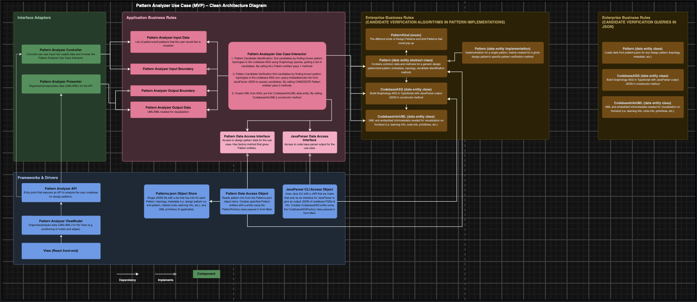

# Pattern Analyzer

This page is the main guide to the Pattern Analyzer use case. Read it before
you change anything in this feature. For the reasons behind the design, see
[ADR-0005: Pattern Analyzer design](adr/0005-pattern-analyzer-design.md).

## What it does

The Pattern Analyzer finds design patterns, such as Singleton, in the user's
Java project. It then draws a UML class diagram of the project and highlights
the classes, members, and relationships that belong to each pattern it found.

The user opens the **Design Pattern Checker** page (`/design-pattern-checker`)
in the web app, picks the patterns to look for, and sees the result.

## Use case diagram



The diagram has two **Enterprise Business Rules** boxes. They show two ways
to verify a candidate:

- **Left box (what the code does):** each pattern has its own subclass, such
as `SingletonDesignPattern`, and that subclass checks candidates in
TypeScript.
- **Right box (not built):** one generic `Pattern` class checks candidates
using queries written in JSON.

The left box is the design in use. ADR-0005, decision 1, explains why.

### Where each box lives in the code

Paths are relative to `clean-architecture-visualizer/`.

| Diagram box                     | Code                                                                                |
| ------------------------------- | ----------------------------------------------------------------------------------- |
| View (React front end)          | `frontend/src/pages/DesignPatternChecker.tsx`, `frontend/src/components/PatternAnalyzer/` |
| Pattern Analyzer ViewModel      | `frontend/src/lib/pattern-analyzer-view-model.ts`                                   |
| Pattern Analyzer API            | `src/server/routes/designPatterns.ts` (`POST /api/design-patterns/analyze`)          |
| Controller                      | `src/interface_adapter/pattern-analyzer/pattern-analyzer-controller.ts`             |
| Presenter                       | `src/interface_adapter/pattern-analyzer/pattern-analyzer-presenter.ts`              |
| Input Data, Input Boundary      | `src/use_case/pattern-analyzer/pattern-analyzer-input-*.ts`                         |
| Output Data, Output Boundary    | `src/use_case/pattern-analyzer/pattern-analyzer-output-*.ts`                        |
| Use Case Interactor             | `src/use_case/pattern-analyzer/pattern-analyzer-interactor.ts`                      |
| Pattern Data Access Interface   | `src/data_access/PatternsAccessInterface.ts`                                        |
| Pattern Data Access Object      | `src/data_access/PatternsAccess.ts`                                                 |
| Patterns.json Object Store      | `src/database/patterns.json`                                                        |
| JavaParser Data Access Interface | `src/data_access/JavaParserCliAccessInterface.ts`                                  |
| JavaParser CLI Access Object    | `src/data_access/JavaParserCliAccess.ts` (runs `lib/javaparser-cli-1.0-SNAPSHOT-all.jar`) |
| PatternKind (enum)              | `src/entity/PatternId.ts`, `PatternName.ts`, `PatternType.ts`                       |
| Pattern (abstract class)        | `src/entity/Pattern.ts`                                                             |
| Pattern (implementation)        | `src/entity/SingletonDesignPattern.ts`                                              |
| Pattern factory                 | `src/entity/PatternFactory.ts`, `src/entity/CommonPatternFactory.ts`                |
| CodebaseASG                     | `src/entity/CodebaseASG.ts`, built by `CommonCodebaseASGFactory.ts`                 |
| CodebaseInfoUML                 | `src/entity/codebase-info-uml.ts`                                                   |
| Main (composition root)         | `src/app/index.ts`                                                                  |

### Where the code differs from the diagram

- **No Graphology.** The diagram says the ASG is built with Graphology. In the
code, `CodebaseASG` is two plain arrays, one of nodes and one of edges.
`Pattern.candidateIdentification` searches them with its own matcher.
- **Three enums, not one.** The diagram's `PatternKind` enum is split into
`PatternId`, `PatternName`, and `PatternType`.
- **Verification looks only at the candidate.** Diagram step 2 says
verification reads more data from the JavaParser output. In the code,
`candidateVerification` sees only the candidate subgraph. If a check needs
more context, add it to the topology so the candidate includes it.
- **The API route wires the use case.** `designPatterns.ts` creates a new
Presenter, Interactor, and Controller for each request. Only
`PatternsAccess` and `JavaParserCliAccess` are created once, in `Main`.

## Key terms

| Term | Meaning |
| --- | --- |
| **ASG** (abstract semantic graph) | The project's classes, interfaces, enums, fields, and methods (nodes), and how they connect (edges). The JavaParser CLI produces it. |
| **CodebaseASG** | The entity that holds an ASG. A candidate is also a `CodebaseASG`: a small piece of the full one. |
| **Pattern** | An entity for one design pattern, holding its metadata and candidate topologies. |
| **Candidate topology** | The shape a pattern must have in the ASG, written as JSON in `patterns.json`. |
| **Candidate** | A subgraph of the project that matches a pattern's topology. It might be the pattern. |
| **Candidate identification** | Pass 1: find every candidate. It's generic and shared by all patterns. |
| **Candidate verification** | Pass 2: decide whether a candidate really is the pattern. Each pattern writes its own check. |
| **Pattern instance** | A candidate that passed verification. The UI highlights it. |
| **CodebaseInfoUML** | The entity that turns the ASG and the pattern instances into UML classes, members, and relationships. |

## How a request flows

1. **Startup.** `src/app/index.ts` creates `PatternsAccess` (with

   `CommonPatternFactory`) and `JavaParserCliAccess` (with
     `CommonCodebaseASGFactory`) once, and gives them to the server. It doesn't
     build any `Pattern` objects yet.
2. **The user opens the page.** `DesignPatternChecker.tsx` calls

   `POST /api/design-patterns/analyze` with the chosen pattern IDs, for
     example `{ "patternIds": ["singleton"] }`.
3. **The route wires the use case.** It creates a Presenter, an Interactor, and

   a Controller, and calls the Controller.
4. **The Controller** converts the request body into a list of strings, puts

   it in `PatternAnalyzerInputData`, and calls the Interactor.
5. **The Interactor:**
   1. Checks every ID with `isPatternId`. If an ID is unknown, it calls

      `prepareInvalidInputView` and stops.
   2. Asks `PatternsAccess.buildPatterns(ids)` for the requested patterns

      only. `PatternsAccess` reads `patterns.json`, checks the name, type,
        and topology shape, and asks the factory to create each `Pattern`.
   3. Asks `JavaParserCliAccess.buildCodebaseASG()` for the ASG. This runs

      `java -jar ... --src <current directory>` and turns the JSON output into
        a `CodebaseASG`.
   4. For each pattern, runs **pass 1** (`candidateIdentification`) and then

      **pass 2** (`candidateVerification`) on each candidate. Candidates that
        pass become pattern instances.
   5. Builds `CodebaseInfoUML` from the full ASG and the pattern instances.
   6. Puts the UML classes, relationships, and pattern instances in

      `PatternAnalyzerOutputData` and calls `prepareSuccessView`.
   7. If anything throws, such as Java not being installed, it calls

      `prepareFailView` with the error message.
6. **The Presenter** turns the result into an HTTP status and a JSON body.
7. **The ViewModel** (`buildPatternAnalyzerViewModel`) lays out the class

   boxes, picks a highlight color for each element, and tracks what the user
     has selected. The View draws it with React Flow.

## API

`POST /api/design-patterns/analyze`

Request body:

```json
{ "patternIds": ["singleton"] }
```

| Status | When | Body |
| --- | --- | --- |
| `200` | Analysis finished | `{ classes, relationships, patternInstances }` |
| `400` | An unknown pattern ID was sent | `{ error }` |
| `500` | The analysis failed, for example the JavaParser CLI failed | `{ error }` |

The response types are in `src/types/codebase-info-uml.ts` (backend) and
`frontend/src/lib/pattern-analyzer-view-model.ts` (frontend). They must stay
the same. Every class, member, and relationship has a `patternInstanceIds`
list, so the frontend knows what to highlight.

## The two passes

### Pass 1: candidate identification (JSON)

`Pattern.candidateIdentification(codebaseASG)` is written once, in
`Pattern.ts`, and works for every pattern. It reads the pattern's
`candidateTopologies` from `patterns.json` and returns every subgraph of the
ASG that matches, as a `CodebaseASG[]`.

How it matches: it tries every way of assigning ASG nodes to the topology's
nodes (each ASG node at most once), then does the same for edges. Edge
properties are checked after the nodes are chosen, so references like
`ownerFqn` and `fieldFqn` must point to the chosen nodes.

**Node types:** `CLASS`, `INTERFACE`, `ENUM`, `FIELD`, `METHOD`.
**Edge types:** `EXTENDS`, `IMPLEMENTS`, `HAS_FIELD`, `HAS_METHOD`,
`MUTATES_FIELD`, `CALLS`. Their properties are in
`src/types/codebaseASGNodes.ts` and `src/types/codebaseASGEdges.ts`.

#### Query rules

| Write this | It means |
| --- | --- |
| Leave the property out | Any value matches. |
| A literal, such as `"CLASS"`, `true`, `""`, or `[]` | Exact match. `""` matches only an empty string. `[]` matches only an empty array. Strings that start with `$` are literal too. |
| An array, such as `["PRIVATE", "STATIC"]` | Same length, same elements, same order. |
| `{ "bind": "name" }` | Matches anything and saves the value as `name`. |
| `{ "equalsBinding": "name" }` | Must equal the value saved as `name`. |
| `{ "contains": value }` | The array has at least one element that matches `value`. For objects, all listed properties must match the same element. |
| `{ "excludes": [values] }` | The array has none of these literal values. `[]` excludes nothing. |
| `{ "oneOf": [values] }` | Matches if any alternative matches. Works anywhere, including `type`. The list must not be empty. |

Rules for bindings:

- A name can be bound only once per topology.
- You must bind a name before you use it. The matcher checks properties in the
order you write them, nodes before edges.
- `contains` and `oneOf` can use existing bindings but can't create new ones.
- Bindings don't carry over from one topology to another.
- Mistakes in bindings are reported before matching starts, even for an empty
ASG.

Other rules:

- **Several topologies = OR.** Each entry in `candidateTopologies` is an
alternative shape. Results are combined, and the same set of ASG nodes and
edges is returned only once. Use `oneOf` when only one value has
alternatives.
- **Extra nodes and edges are fine.** A match only has to contain the
topology. Each returned candidate holds only the nodes and edges that were
matched.
- **Not supported:** "this must not exist" queries, transitive paths (for
example "A eventually calls B"), and data the ASG doesn't contain.

#### Example: Singleton

The Singleton topology binds the class FQN as `singletonClass`. It then
requires a field whose `typeFqn` is that class and a method whose
`returnTypeFqn` is that class, with `HAS_FIELD` and `HAS_METHOD` edges from the
class. Its modifier lists use `oneOf` because array order matters and the
parser keeps source order. `private static` gives `["PRIVATE", "STATIC"]`, and
`static private` gives `["STATIC", "PRIVATE"]`. Both should match.

Another example, two methods with exactly the same parameter list:

```json
{
  "nodes": [
    { "type": "METHOD", "parameterFqns": { "bind": "parameters" } },
    { "type": "METHOD", "parameterFqns": { "equalsBinding": "parameters" } }
  ],
  "edges": []
}
```

#### Collecting a variable number of matches (`collectMatches`)

A topology has a fixed number of nodes. To also gather "every X related to
the match", add a `collectMatches` list. After the main topology matches,
each collection searches the whole ASG again, using the main match's
bindings, and adds everything it finds to the candidate.

This collects every method with no parameters owned by each class, and needs
at least one:

```json
{
  "nodes": [{ "type": "CLASS", "fqn": { "bind": "owner" } }],
  "edges": [],
  "collectMatches": [
    {
      "nodes": [
        { "type": "METHOD", "fqn": { "bind": "method" }, "parameterFqns": [] }
      ],
      "edges": [
        {
          "type": "HAS_METHOD",
          "ownerFqn": { "equalsBinding": "owner" },
          "methodFqn": { "equalsBinding": "method" }
        }
      ],
      "minMatches": 1
    }
  ]
}
```

- A collection needs `nodes` and `edges` arrays with at least one query
between them.
- `minMatches` defaults to `0`. If fewer distinct matches are found, the whole
candidate is dropped. Matches are distinct if they use different ASG
nodes or edges. For example, two ownership edges to the same method count as
two matches.
- Bindings made inside a collection stay inside it. Different collections can
reuse the same names.
- Everything collected is merged into one `CodebaseASG`. The candidate
doesn't record which collection added which node. Identical candidates are
returned once.

### Pass 2: candidate verification (TypeScript)

Each pattern subclass implements:

```ts
candidateVerification(candidateASG: CodebaseASG): boolean
```

Put every rule here that the topology can't express, or that is clearer in
code. `SingletonDesignPattern` checks that the candidate has exactly one
class, field, and method. It also checks that the field is named `instance`
and is exactly `private static`, and that the method is named `getInstance`,
is exactly `public static`, takes no parameters, and returns the class.

Verification must look only at the candidate it receives. It must not read
JSON or call data access.

## Adding a new pattern

Use Singleton as your template and compare against it at each step. The
`add-pattern` agent skill (`.agents/skills/add-pattern/`) walks through the
same steps.

1. **JSON.** Add the pattern's metadata (`patternName`, `patternType`,

   `description`, `learningInfo`) and `candidateTopologies` to
     `clean-architecture-visualizer/src/database/patterns.json`. The key is the
     pattern ID.
2. **Enums.** Add its ID, name, and (if new) type to

   `src/entity/PatternId.ts`, `PatternName.ts`, and `PatternType.ts`.
3. **Entity.** Create `src/entity/` + the pattern's class file (for example

   `ObserverDesignPattern.ts`). Extend `Pattern`, check the ID, name, and type
     in the constructor, and implement `candidateVerification`.
4. **Factory.** Register the class in `patternRegistry` in

   `src/entity/CommonPatternFactory.ts`.
5. **Frontend.** Add `{ id, name }` to `AVAILABLE_PATTERNS` in

   `frontend/src/lib/pattern-analyzer-view-model.ts` so users can choose it.
6. **Tests.** Test both passes: that the topology finds the right candidates,

   and that verification accepts real examples and rejects near misses. Then
     run the backend tests.

Keep JSON reading and metadata checks in `PatternsAccess`. Pattern entities
must not depend on JSON or on `PatternsAccess`.

## Testing

From `clean-architecture-visualizer/`:

```bash
npm test                        # backend (Jest)
cd frontend && npm run test:unit  # frontend (Vitest)
```

| What | Test file (under `clean-architecture-visualizer/`) |
| --- | --- |
| Matcher and query rules | `tests/backend/entity/pattern.test.ts` |
| Singleton verification | `tests/backend/entity/singletonPattern.test.ts` |
| Factory | `tests/backend/entity/patternFactory.test.ts` |
| Reading `patterns.json` | `tests/backend/data_access/patternsAccess.test.ts` |
| JavaParser CLI access | `tests/backend/data_access/javaParserCliAccess.test.ts` |
| UML building | `tests/backend/entity/codebase-info-uml.test.ts` |
| Interactor | `tests/backend/use_cases/pattern-analyzer.test.ts` |
| API route | `tests/backend/server/pattern-analyzer-routes.test.ts` |
| ViewModel | `frontend/tests/unit/lib/pattern-analyzer-view-model.test.ts` |
| Page | `frontend/tests/unit/pages/DesignPatternChecker.test.tsx` |

Shared fixtures: `tests/backend/fixtures/singleton-asg.ts`,
`tests/backend/fixtures/patterns.custom.json`, and
`tests/fixtures/javaparser-cli-output.json`.

## Known limitations

- **Java is required.** The user's machine must have `java` on its path, or
every analysis returns `500`.
- **The project is parsed on every request.** There's no caching, so large
projects are slow to analyze each time.
- **The matcher can be slow.** It tries combinations of nodes, so large  
topologies on large codebases can take a long time.
- **The whole project is sent.** The response contains the UML for every
class, not only the ones in a pattern.
